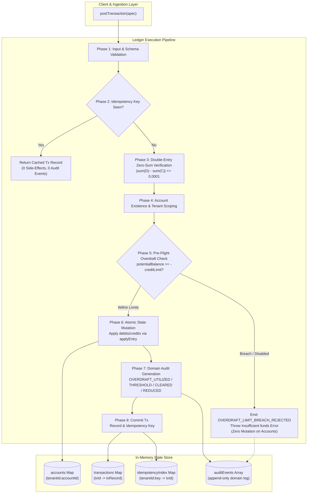
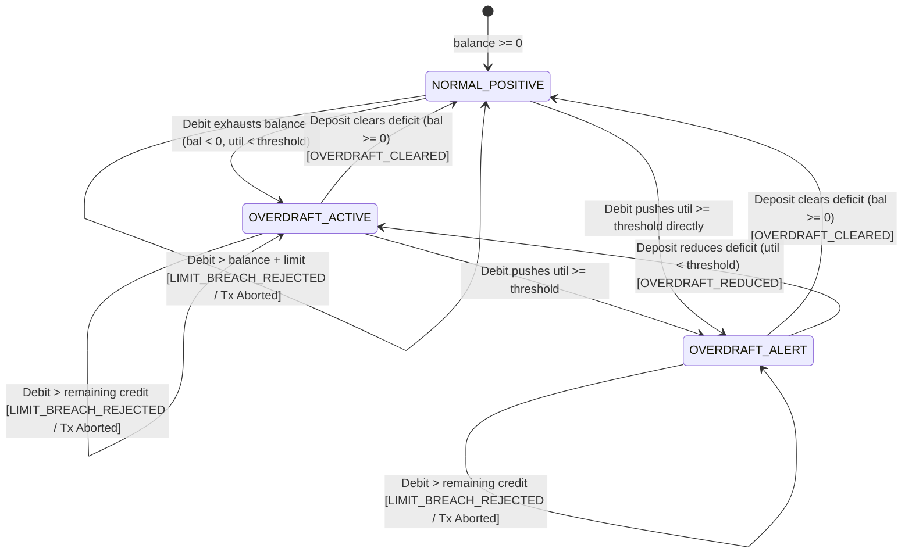

# ADR-002: Credit Overdraft Invariants, Execution Pipeline & Audit Subsystem Architecture

## 1. Context & Business Problem

Apex Enterprise Ledger Service (`apex-ledger`) provides financial accounting, API metering, and transaction settlement for multi-tenant enterprise platforms. In the baseline system (Epic 1), any transaction drawing an account's balance below zero triggers an unrecoverable `Insufficient funds` error. For tier-1 enterprise customers with negotiated corporate credit facilities, this abrupt rejection causes dropped batch jobs, streaming API call interruptions, and manual operational interventions.

Epic 2 (Story 2.1) introduces **Enterprise Credit Overdraft Protection**, transforming the ledger into a hybrid pre-paid/credit-line settlement engine. This document establishes the technical architecture, mathematical invariants, state machine, and tamper-evident audit subsystem required to implement Story 2.1 while strictly preserving backward compatibility, zero-sum double-entry accounting, tenant boundary isolation, and deterministic 4-decimal arithmetic.

---

## 2. Architectural Principles & Consistency Invariants

```
+----------------------------------------------------------------------------------------------------------+
|                                    CORE LEDGER INVARIANT BOUNDARIES                                      |
+----------------------------------------------------------------------------------------------------------+
|                                                                                                          |
|   1. Double-Entry Zero-Sum:       sum(Debits) == sum(Credits)  [tolerance <= 0.0001]                     |
|   2. Balance Floor Invariant:     account.balance >= -account.creditLimit                                |
|   3. Atomic State Transitions:    All-or-nothing execution; zero side-effects on rejection               |
|   4. Deterministic Arithmetic:    Math.round(val * 10000) / 10000 (IEEE 754 drift prevention)            |
|   5. Tenant Isolation:            Every operation, account, and audit event scoped by tenantId           |
|   6. Idempotent Deduplication:    Replayed keys return cached record; 0 redundant balance/audit effects  |
|   7. Audit Immutability:          Append-only event log; query API returns frozen/defensively cloned data |
|                                                                                                          |
+----------------------------------------------------------------------------------------------------------+
```

---

## 3. Architecture Decisions & System Design



---

### AD-002.1: Account Class Extension & Policy Model

- **Binds:** `src/account.mjs`, `Account` constructor, runtime validation, balance calculation methods.
- **Prevents:** Undefined configuration states, silent negative balance overflows, runtime `NaN` pollution, and invalid threshold ranges.
- **Rule:** The `Account` entity is extended to encapsulate credit line parameters with strict validation:

```typescript
interface AccountSpec {
  id: string;                                // Non-empty string
  tenantId: string;                          // Non-empty string
  type: 'asset' | 'liability' | 'equity' | 'revenue' | 'expense';
  currency?: string;                         // Defaults to 'USD'
  creditLimit?: number;                      // Non-negative finite number, default 0
  overdraftEnabled?: boolean;                // Boolean, defaults to (creditLimit > 0)
  overdraftAlertThreshold?: number;          // Number in [0.0, 1.0], default 0.8
}
```

#### Constructor Validation Specifications:
1. `creditLimit`: Must satisfy `typeof creditLimit === 'number' && creditLimit >= 0 && Number.isFinite(creditLimit)`. Otherwise, throw `new TypeError('creditLimit must be a non-negative finite number')`.
2. `overdraftEnabled`: If provided, must satisfy `typeof overdraftEnabled === 'boolean'`. If `undefined`, default to `creditLimit > 0`. Otherwise, throw `new TypeError('overdraftEnabled must be a boolean')`.
3. `overdraftAlertThreshold`: Must satisfy `typeof overdraftAlertThreshold === 'number' && overdraftAlertThreshold >= 0 && overdraftAlertThreshold <= 1 && Number.isFinite(overdraftAlertThreshold)`. If `undefined`, default to `0.8`. Otherwise, throw `new TypeError('overdraftAlertThreshold must be a number between 0 and 1')`.

#### Account Balance Calculation Helpers:
- `getOverdraftUtilized()`:
  $$\text{overdraftUtilized} = \begin{cases} \text{Math.round}(|\text{this.balance}| \cdot 10000) / 10000 & \text{if } \text{this.balance} < 0 \\ 0.0000 & \text{otherwise} \end{cases}$$
- `getRemainingCredit()`:
  $$\text{remainingCredit} = \begin{cases} \text{Math.round}(\max(0, \text{this.creditLimit} - \text{this.getOverdraftUtilized()}) \cdot 10000) / 10000 & \text{if } \text{this.overdraftEnabled} \\ 0.0000 & \text{otherwise} \end{cases}$$
- `getOverdraftUtilizationRatio()`:
  $$\text{utilizationRatio} = \begin{cases} \text{Math.round}((\text{this.getOverdraftUtilized()} / \text{this.creditLimit}) \cdot 10000) / 10000 & \text{if } \text{this.creditLimit} > 0 \\ 0.0000 & \text{otherwise} \end{cases}$$
- `getAvailablePurchasingPower()`:
  $$\text{availablePurchasingPower} = \text{Math.round}((\text{this.balance} + (\text{this.overdraftEnabled} ? \text{this.creditLimit} : 0)) \cdot 10000) / 10000$$

---

### AD-002.2: Ledger Pipeline & Pre-Flight Atomic Verification

- **Binds:** `src/ledger.mjs`, `Ledger.postTransaction`, `Ledger.createAccount`, `Ledger.getAuditEvents`.
- **Prevents:** Partial transaction application, corrupted multi-account balances on mid-transaction failure, and duplicate audit dispatches.
- **Rule:** `Ledger.postTransaction` must execute as an 8-phase atomic pipeline:

#### Phase 1: Input & Schema Validation
- Validate transaction `id` (non-empty string), `tenantId` (non-empty string), and `entries` (array with length $\ge 2$).
- Validate each entry: `amount` (finite positive number $> 0$) and `direction` (`'debit'` or `'credit'`).

#### Phase 2: Idempotency Deduplication Check
- If `idempotencyKey` is provided:
  - Construct scoped lookup key: `tenantId + ':' + idempotencyKey`.
  - If existing `txId` is found in `this.idempotencyIndex`:
    - Return `this.transactions.get(existingTxId)` immediately.
    - **CRITICAL INVARIANT:** Do not evaluate balances, do not mutate state, and do not emit any audit events.

#### Phase 3: Double-Entry Zero-Sum Balance Check
- Calculate `totalDebit` and `totalCredit`.
- Evaluate discrepancy: `diff = Math.abs(Math.round((totalDebit - totalCredit) * 10000) / 10000)`.
- If `diff > 0.0001`:
  - Throw `new Error(\`Unbalanced transaction: debits (\${totalDebit}) != credits (\${totalCredit})\`)`.

#### Phase 4: Account Existence & Tenant Ownership
- Resolve each account using `this.getAccount(tenantId, entry.accountId)`.
- If any account does not exist or does not match `tenantId`:
  - Throw `new Error(\`Account \${entry.accountId} not found for tenant \${tenantId}\`)`.

#### Phase 5: Pre-Flight Overdraft Check (Atomic Evaluation)
- For every entry that causes an account's balance to decrease:
  - Condition: `(account.isDebitNormal() && entry.direction === 'credit') || (!account.isDebitNormal() && entry.direction === 'debit')`.
  - Compute potential balance:
    $$\text{potentialBalance} = \text{Math.round}((\text{account.balance} - \text{entry.amount}) \cdot 10000) / 10000$$
  - If $\text{potentialBalance} < 0$:
    - Check if overdraft is permitted:
      $$\text{isPermitted} = \text{account.overdraftEnabled} \land (\text{potentialBalance} \ge -\text{account.creditLimit})$$
    - If `!isPermitted`:
      - Construct and append `OVERDRAFT_LIMIT_BREACH_REJECTED` audit event to `this.auditEvents`.
      - Throw `new Error(\`Insufficient funds: account \${account.id} balance is \${account.balance}, creditLimit is \${account.creditLimit}, requested \${entry.amount}\`)`.
      - **CRITICAL INVARIANT (Atomic Rollback):** Terminate immediately. None of the accounts in the transaction have their balances modified. No transaction record is stored in `this.transactions`. No key is registered in `this.idempotencyIndex`.

#### Phase 6: State Mutation
- Iterate through resolved entries and invoke `account.applyEntry(entry.amount, entry.direction)`.
- All operations succeed deterministically since validation and pre-flight checks are already complete.

#### Phase 7: Domain Audit Event Generation
- Evaluate prior vs. new balance transitions for each account involved in the transaction:
  1. **New or Deepened Overdraft (`OVERDRAFT_UTILIZED`):**
     - Emitted if `newBalance < 0` and (`priorBalance >= 0` or `newBalance < priorBalance`).
  2. **Threshold Exceeded (`OVERDRAFT_THRESHOLD_EXCEEDED`):**
     - Emitted if `newBalance < 0` and `newUtilRatio >= account.overdraftAlertThreshold` (and `priorUtilRatio < account.overdraftAlertThreshold` or utilization increased).
  3. **Full Restitution (`OVERDRAFT_CLEARED`):**
     - Emitted if `priorBalance < 0` and `newBalance >= 0`.
  4. **Partial Restitution (`OVERDRAFT_REDUCED`):**
     - Emitted if `priorBalance < 0` and `newBalance < 0` and `newBalance > priorBalance`.

#### Phase 8: Transaction Record & Idempotency Commitment
- If any account utilized overdraft during this transaction (`account.balance < 0`), enrich `txRecord` with:
  - `overdraftUtilized: true`
  - `overdraftAmount: Math.abs(account.balance)`
  - `remainingCredit: account.getRemainingCredit()`
- Commit `txRecord` to `this.transactions.set(id, txRecord)`.
- If `idempotencyKey` provided: `this.idempotencyIndex.set(\`\${tenantId}:\${idempotencyKey}\`, id)`.
- Return `txRecord`.

---

### AD-002.3: Mathematical Invariants & Formal Proofs



#### Invariant 1: Double-Entry Zero-Sum Balance Conservation
$$\forall T = \{e_1, e_2, \dots, e_k\}, \quad \left| \sum_{i=1}^k \mathbb{I}(e_i.\text{direction} = \text{'debit'}) \cdot e_i.\text{amount} - \sum_{i=1}^k \mathbb{I}(e_i.\text{direction} = \text{'credit'}) \cdot e_i.\text{amount} \right| \le 10^{-4}$$
*Proof:* The ledger evaluates the absolute rounded difference before resolving accounts. Transactions violating this condition throw `Unbalanced transaction` at Phase 3, guaranteeing that total assets, liabilities, and equity across the ledger remain balanced.

#### Invariant 2: Account Balance Floor & Credit Hard Ceiling
$$\forall \text{ Account } A \text{ belonging to Tenant } \tau: \quad A.\text{balance} \ge - (A.\text{overdraftEnabled} \cdot A.\text{creditLimit})$$
*Proof:* In Phase 5, any debit causing `potentialBalance < -account.creditLimit` (or `potentialBalance < 0` when `overdraftEnabled === false`) triggers an immediate exception before `applyEntry` is invoked on any account. Consequently, no account balance can ever drop below `-creditLimit`.

#### Invariant 3: Atomic Rejection with Zero State Mutation
$$\text{If } \exists e_i \in T \text{ breaching limit} \implies \mathcal{S}_{\text{accounts}}(t^+) = \mathcal{S}_{\text{accounts}}(t^-) \land \mathcal{S}_{\text{transactions}}(t^+) = \mathcal{S}_{\text{transactions}}(t^-)$$
*Proof:* Account balance mutations occur exclusively in Phase 6. Phase 5 inspection aborts execution via `throw` prior to Phase 6. In-memory accounts remain identical to their initial states.

#### Invariant 4: Linear Credit Deficit Amortization
When an account carrying balance $B_0 < 0$ receives credit $C > 0$:
$$B_1 = \text{round}_4(B_0 + C)$$
- If $B_1 \ge 0$: $\text{overdraftUtilized} = 0$, $\text{remainingCredit} = \text{creditLimit}$ $\implies$ Emits `OVERDRAFT_CLEARED`.
- If $B_1 < 0$: $\text{overdraftUtilized} = |B_1|$, $\text{remainingCredit} = \text{creditLimit} - |B_1|$ $\implies$ Emits `OVERDRAFT_REDUCED`.

#### Invariant 5: Idempotency Replay Determinism & Audit Silence
$$\text{Let } \text{postTransaction}(T_1) \to R_1 \text{ at } t_1. \quad \text{Then } \text{postTransaction}(T_1) \to R_1 \text{ at } t_2 \land \text{AuditLogs}(t_2) = \text{AuditLogs}(t_1)$$
*Proof:* Handled in Phase 2 via `idempotencyIndex`. The cached record is returned synchronously without executing Phases 3–8.

---

### AD-002.4: Ledger State Storage & Audit Query API

- **Binds:** `Ledger.prototype.getAuditEvents`, `this.auditEvents`.
- **Prevents:** Cross-tenant data leakage, external mutation of historical audit logs, and out-of-order event reporting.
- **Rule:** The ledger maintains an in-memory audit store and exposes a defensive query API:

```javascript
getAuditEvents(tenantId, accountId = null)
```

#### Query Execution Rules:
1. `tenantId` is mandatory. Throws `TypeError('tenantId required')` if omitted or non-string.
2. Filters `this.auditEvents` matching `event.tenantId === tenantId`.
3. If `accountId` is specified, further filters by `event.accountId === accountId`.
4. Returns a chronologically sorted array of event objects.
5. **Defensive Immutability:** Each returned event object is defensively cloned (e.g. `JSON.parse(JSON.stringify(event))` or `structuredClone(event)`) to prevent caller mutations from affecting internal ledger state.

---

### AD-002.5: Audit Event Taxonomy & Schemas

All emitted audit events conform to the following structured contract:

```typescript
interface LedgerAuditEvent {
  id: string;                                // 'evt_' + timestamp + '_' + randomString
  tenantId: string;                          // Scoped tenant ID
  accountId: string;                         // Target account ID
  transactionId: string;                     // Causing transaction ID (or 'config_' for admin)
  type: 'OVERDRAFT_UTILIZED'
      | 'OVERDRAFT_THRESHOLD_EXCEEDED'
      | 'OVERDRAFT_LIMIT_BREACH_REJECTED'
      | 'OVERDRAFT_CLEARED'
      | 'OVERDRAFT_REDUCED'
      | 'OVERDRAFT_CONFIG_UPDATED';
  timestamp: number;                         // Date.now()
  currentBalance: number;                    // 4-decimal rounded balance
  creditLimit: number;                       // Configured credit limit
  overdraftUtilized: number;                 // Math.max(0, -currentBalance)
  remainingCredit: number;                   // Available remaining overdraft credit
  details: Record<string, unknown>;          // Diagnostic context
}
```

#### Event Details Payload Specification:

| Event Type | Trigger Condition | Details Payload Contents |
| :--- | :--- | :--- |
| `OVERDRAFT_UTILIZED` | Account balance drops below 0 or deepens negative | `{ priorBalance, delta, utilizationRatio }` |
| `OVERDRAFT_THRESHOLD_EXCEEDED` | Overdraft utilization $\ge$ `overdraftAlertThreshold` | `{ utilizationRatio, alertThreshold, warning }` |
| `OVERDRAFT_LIMIT_BREACH_REJECTED` | Transaction rejected due to limit breach or disabled flag | `{ requestedAmount, potentialBalance, excessAmount }` |
| `OVERDRAFT_CLEARED` | Inbound credit restores account balance to $\ge 0$ | `{ priorBalance, clearedDeficit, creditDeposit }` |
| `OVERDRAFT_REDUCED` | Inbound credit partially pays down negative balance | `{ priorBalance, repaidPortion }` |
| `OVERDRAFT_CONFIG_UPDATED` | Account credit policy modified | `{ previousCreditLimit, newCreditLimit, overdraftEnabled, overdraftAlertThreshold }` |

---

### AD-002.6: Atomic Rejection & Error Semantics

- **Error Type:** `Error` (matching regex `/Insufficient funds/` for backward compatibility with baseline tests).
- **Exact Message Pattern:**
  ```text
  Insufficient funds: account ${account.id} balance is ${account.balance}, creditLimit is ${account.creditLimit}, requested ${entry.amount}
  ```
- **Structured Error Properties (for programmatic inspection):**
  - `name: 'InsufficientFundsError'`
  - `code: 'INSUFFICIENT_FUNDS'`
  - `tenantId: account.tenantId`
  - `accountId: account.id`
  - `currentBalance: account.balance`
  - `creditLimit: account.creditLimit`
  - `requestedAmount: entry.amount`
  - `availablePurchasingPower: account.getAvailablePurchasingPower()`

---

## 4. Class Interface Blueprints (Developer Handoff Specification)

### 4.1 `Account` Class Blueprint (`src/account.mjs`)

```javascript
export class Account {
  constructor({
    id,
    tenantId,
    type,
    currency = 'USD',
    creditLimit = 0,
    overdraftEnabled,
    overdraftAlertThreshold = 0.8
  }) {
    if (!id || typeof id !== 'string') {
      throw new TypeError('Account id must be a non-empty string');
    }
    if (!tenantId || typeof tenantId !== 'string') {
      throw new TypeError('tenantId must be a non-empty string');
    }
    const validTypes = ['asset', 'liability', 'equity', 'revenue', 'expense'];
    if (!validTypes.includes(type)) {
      throw new TypeError(`Invalid account type: ${type}. Must be one of ${validTypes.join(', ')}`);
    }
    if (typeof creditLimit !== 'number' || creditLimit < 0 || !Number.isFinite(creditLimit)) {
      throw new TypeError('creditLimit must be a non-negative finite number');
    }
    if (overdraftEnabled !== undefined && typeof overdraftEnabled !== 'boolean') {
      throw new TypeError('overdraftEnabled must be a boolean');
    }
    if (
      typeof overdraftAlertThreshold !== 'number' ||
      overdraftAlertThreshold < 0 ||
      overdraftAlertThreshold > 1 ||
      !Number.isFinite(overdraftAlertThreshold)
    ) {
      throw new TypeError('overdraftAlertThreshold must be a number between 0 and 1');
    }

    this.id = id;
    this.tenantId = tenantId;
    this.type = type;
    this.currency = currency;
    this.balance = 0;
    this.creditLimit = creditLimit;
    this.overdraftEnabled = overdraftEnabled !== undefined ? overdraftEnabled : creditLimit > 0;
    this.overdraftAlertThreshold = overdraftAlertThreshold;
  }

  isDebitNormal() {
    return this.type === 'asset' || this.type === 'expense';
  }

  getOverdraftUtilized() {
    return this.balance < 0 ? Math.round(Math.abs(this.balance) * 10000) / 10000 : 0;
  }

  getRemainingCredit() {
    if (!this.overdraftEnabled) return 0;
    return Math.round(Math.max(0, this.creditLimit - this.getOverdraftUtilized()) * 10000) / 10000;
  }

  getOverdraftUtilizationRatio() {
    if (this.creditLimit <= 0) return 0;
    return Math.round((this.getOverdraftUtilized() / this.creditLimit) * 10000) / 10000;
  }

  getAvailablePurchasingPower() {
    const credit = this.overdraftEnabled ? this.creditLimit : 0;
    return Math.round((this.balance + credit) * 10000) / 10000;
  }

  applyEntry(amount, direction) {
    if (typeof amount !== 'number' || amount <= 0 || !Number.isFinite(amount)) {
      throw new TypeError('Amount must be a positive finite number');
    }
    if (direction !== 'debit' && direction !== 'credit') {
      throw new TypeError('Direction must be either debit or credit');
    }

    if (this.isDebitNormal()) {
      if (direction === 'debit') {
        this.balance += amount;
      } else {
        this.balance -= amount;
      }
    } else {
      if (direction === 'credit') {
        this.balance += amount;
      } else {
        this.balance -= amount;
      }
    }
    this.balance = Math.round(this.balance * 10000) / 10000;
  }
}
```

---

### 4.2 `Ledger` Class Blueprint (`src/ledger.mjs`)

```javascript
import { Account } from './account.mjs';

export class Ledger {
  constructor() {
    this.accounts = new Map();
    this.transactions = new Map();
    this.idempotencyIndex = new Map();
    this.auditEvents = [];
  }

  createAccount(spec) {
    const account = new Account(spec);
    const key = `${account.tenantId}:${account.id}`;
    if (this.accounts.has(key)) {
      throw new Error(`Account already exists: ${account.id} for tenant ${account.tenantId}`);
    }
    this.accounts.set(key, account);
    return account;
  }

  getAccount(tenantId, accountId) {
    const key = `${tenantId}:${accountId}`;
    return this.accounts.get(key) || null;
  }

  getAuditEvents(tenantId, accountId = null) {
    if (!tenantId || typeof tenantId !== 'string') {
      throw new TypeError('tenantId required');
    }
    let events = this.auditEvents.filter(e => e.tenantId === tenantId);
    if (accountId) {
      events = events.filter(e => e.accountId === accountId);
    }
    // Return defensive clone
    return events.map(e => JSON.parse(JSON.stringify(e)));
  }

  _emitAuditEvent({ tenantId, accountId, transactionId, type, currentBalance, creditLimit, details = {} }) {
    const overdraftUtilized = currentBalance < 0 ? Math.round(Math.abs(currentBalance) * 10000) / 10000 : 0;
    const remainingCredit = Math.round(Math.max(0, creditLimit - overdraftUtilized) * 10000) / 10000;
    const event = {
      id: `evt_${Date.now()}_${Math.random().toString(36).slice(2, 9)}`,
      tenantId,
      accountId,
      transactionId,
      type,
      timestamp: Date.now(),
      currentBalance,
      creditLimit,
      overdraftUtilized,
      remainingCredit,
      details
    };
    this.auditEvents.push(event);
    return event;
  }

  postTransaction({ id, tenantId, idempotencyKey, timestamp = Date.now(), description = '', entries = [] }) {
    if (!id || typeof id !== 'string') throw new TypeError('Transaction id required');
    if (!tenantId || typeof tenantId !== 'string') throw new TypeError('tenantId required');
    if (!Array.isArray(entries) || entries.length < 2) {
      throw new Error('Transaction must contain at least 2 entries');
    }

    // 1. Check idempotency
    if (idempotencyKey) {
      const existingTxId = this.idempotencyIndex.get(`${tenantId}:${idempotencyKey}`);
      if (existingTxId) {
        return this.transactions.get(existingTxId);
      }
    }

    // 2. Verify double-entry zero sum: debits == credits
    let totalDebit = 0;
    let totalCredit = 0;

    for (const entry of entries) {
      if (typeof entry.amount !== 'number' || entry.amount <= 0 || !Number.isFinite(entry.amount)) {
        throw new TypeError('Entry amount must be positive finite number');
      }
      if (entry.direction === 'debit') totalDebit += entry.amount;
      else if (entry.direction === 'credit') totalCredit += entry.amount;
      else throw new TypeError('Invalid direction, must be debit or credit');
    }

    const diff = Math.abs(Math.round((totalDebit - totalCredit) * 10000) / 10000);
    if (diff > 0.0001) {
      throw new Error(`Unbalanced transaction: debits (${totalDebit}) != credits (${totalCredit})`);
    }

    // 3. Verify all accounts exist and belong to tenant
    const resolvedAccounts = [];
    for (const entry of entries) {
      const acc = this.getAccount(tenantId, entry.accountId);
      if (!acc) {
        throw new Error(`Account ${entry.accountId} not found for tenant ${tenantId}`);
      }
      resolvedAccounts.push({ account: acc, entry });
    }

    // 4. Pre-flight Balance & Overdraft Checks (Atomic Evaluation)
    for (const { account, entry } of resolvedAccounts) {
      const willDecrease = (account.isDebitNormal() && entry.direction === 'credit') ||
                           (!account.isDebitNormal() && entry.direction === 'debit');
      if (willDecrease) {
        const potentialBalance = Math.round((account.balance - entry.amount) * 10000) / 10000;
        const creditLimit = account.creditLimit || 0;
        const overdraftAllowed = account.overdraftEnabled && potentialBalance >= -creditLimit;

        if (potentialBalance < 0 && !overdraftAllowed) {
          // Record limit breach rejection audit event
          this._emitAuditEvent({
            tenantId,
            accountId: account.id,
            transactionId: id,
            type: 'OVERDRAFT_LIMIT_BREACH_REJECTED',
            currentBalance: account.balance,
            creditLimit,
            details: {
              requestedAmount: entry.amount,
              potentialBalance,
              excessAmount: Math.round((Math.abs(potentialBalance) - creditLimit) * 10000) / 10000
            }
          });

          // Throw structured Insufficient funds error without modifying any account state
          const err = new Error(
            `Insufficient funds: account ${account.id} balance is ${account.balance}, creditLimit is ${creditLimit}, requested ${entry.amount}`
          );
          err.name = 'InsufficientFundsError';
          err.code = 'INSUFFICIENT_FUNDS';
          err.tenantId = tenantId;
          err.accountId = account.id;
          err.currentBalance = account.balance;
          err.creditLimit = creditLimit;
          err.requestedAmount = entry.amount;
          throw err;
        }
      }
    }

    // 5. Apply entries and record transitions
    let txOverdraftUtilized = false;
    let maxOverdraftAmount = 0;
    let minRemainingCredit = Infinity;

    for (const { account, entry } of resolvedAccounts) {
      const priorBalance = account.balance;
      account.applyEntry(entry.amount, entry.direction);
      const newBalance = account.balance;

      // Overdraft telemetry tracking
      if (newBalance < 0) {
        txOverdraftUtilized = true;
        const currentOverdraft = Math.abs(newBalance);
        if (currentOverdraft > maxOverdraftAmount) maxOverdraftAmount = currentOverdraft;
        const remCredit = account.getRemainingCredit();
        if (remCredit < minRemainingCredit) minRemainingCredit = remCredit;

        // Transition: NORMAL -> OVERDRAFT or Deepened Overdraft
        this._emitAuditEvent({
          tenantId,
          accountId: account.id,
          transactionId: id,
          type: 'OVERDRAFT_UTILIZED',
          currentBalance: newBalance,
          creditLimit: account.creditLimit,
          details: {
            priorBalance,
            delta: Math.round((newBalance - priorBalance) * 10000) / 10000,
            utilizationRatio: account.getOverdraftUtilizationRatio()
          }
        });

        // Threshold check
        const utilRatio = account.getOverdraftUtilizationRatio();
        if (utilRatio >= account.overdraftAlertThreshold) {
          this._emitAuditEvent({
            tenantId,
            accountId: account.id,
            transactionId: id,
            type: 'OVERDRAFT_THRESHOLD_EXCEEDED',
            currentBalance: newBalance,
            creditLimit: account.creditLimit,
            details: {
              utilizationRatio: utilRatio,
              alertThreshold: account.overdraftAlertThreshold,
              warning: `Account credit utilization has reached ${(utilRatio * 100).toFixed(1)}%`
            }
          });
        }
      } else if (priorBalance < 0 && newBalance >= 0) {
        // Transition: OVERDRAFT -> NORMAL (Full Clearance)
        this._emitAuditEvent({
          tenantId,
          accountId: account.id,
          transactionId: id,
          type: 'OVERDRAFT_CLEARED',
          currentBalance: newBalance,
          creditLimit: account.creditLimit,
          details: {
            priorBalance,
            clearedDeficit: Math.abs(priorBalance),
            creditDeposit: entry.amount
          }
        });
      } else if (priorBalance < 0 && newBalance < 0 && newBalance > priorBalance) {
        // Transition: Partial Overdraft Repayment
        this._emitAuditEvent({
          tenantId,
          accountId: account.id,
          transactionId: id,
          type: 'OVERDRAFT_REDUCED',
          currentBalance: newBalance,
          creditLimit: account.creditLimit,
          details: {
            priorBalance,
            repaidPortion: Math.round((newBalance - priorBalance) * 10000) / 10000
          }
        });
      }
    }

    const txRecord = {
      id,
      tenantId,
      idempotencyKey: idempotencyKey || null,
      timestamp,
      description,
      entries: entries.map(e => ({ ...e })),
      status: 'POSTED',
      ...(txOverdraftUtilized && {
        overdraftUtilized: true,
        overdraftAmount: maxOverdraftAmount,
        remainingCredit: minRemainingCredit
      })
    };

    this.transactions.set(id, txRecord);
    if (idempotencyKey) {
      this.idempotencyIndex.set(`${tenantId}:${idempotencyKey}`, id);
    }

    return txRecord;
  }
}
```

---

## 5. Traceability & Capability Mapping

| Story Acceptance Criteria | PRD Requirement | Architecture Rule | Governing Method / Class |
| :--- | :--- | :--- | :--- |
| **AC1: Account Policy Configuration** | FR-1 | AD-002.1 | `Account.prototype.constructor` (Validation of `creditLimit`, `overdraftEnabled`, `overdraftAlertThreshold`) |
| **AC2: Dynamic Overdraft Execution** | FR-2 | AD-002.2, AD-002.3 | `Ledger.prototype.postTransaction` (Phase 5, 6, 7; `txRecord.overdraftUtilized`) |
| **AC3: Limit Hard Cap Enforcement** | FR-3 | AD-002.2, AD-002.6 | `Ledger.prototype.postTransaction` (Phase 5 pre-flight check, zero side-effects rollback) |
| **AC4: Threshold Alert Triggers** | FR-4 | AD-002.2, AD-002.5 | `Ledger.prototype._emitAuditEvent` (`OVERDRAFT_THRESHOLD_EXCEEDED` trigger) |
| **AC5: Inbound Settlement Clearance** | FR-5 | AD-002.2, AD-002.3 | `Ledger.prototype.postTransaction` (Phase 7; `OVERDRAFT_CLEARED` & `OVERDRAFT_REDUCED`) |
| **AC6: Audit Trail & Idempotency** | FR-4, NFR-3, NFR-5 | AD-002.4, AD-002.7 | `Ledger.prototype.getAuditEvents`, `idempotencyIndex` short-circuit |

---

## 6. Verification & Test Strategy

To verify this architecture, the test suite (`test/ledger.test.mjs`) must be expanded with comprehensive test cases addressing:
1. **Existing Baseline Tests:** Ensure all 4 existing tests pass with zero regressions (including `/Insufficient funds/` regex matching).
2. **Account Configuration Unit Tests:** Test valid and invalid types for `creditLimit`, `overdraftEnabled`, and `overdraftAlertThreshold`.
3. **Overdraft Transaction Execution:** Test debit drawing balance into negative; verify balance, transaction metadata, and `OVERDRAFT_UTILIZED` event.
4. **Hard Limit Boundary Rejections:** Test transaction requiring `balance < -creditLimit`; verify rejection error message, zero balance mutations on all accounts, and `OVERDRAFT_LIMIT_BREACH_REJECTED` audit event.
5. **Threshold Exceeded Alert Events:** Test transaction reaching $\ge 80\%$ utilization; verify `OVERDRAFT_THRESHOLD_EXCEEDED` alongside `OVERDRAFT_UTILIZED`.
6. **Inbound Clearance & Reduction:** Test deposits clearing or partially reducing negative balances; verify `OVERDRAFT_CLEARED` and `OVERDRAFT_REDUCED` events.
7. **Idempotency Deduplication:** Re-post transaction with same key; verify cached response and zero duplicate audit events.
8. **Multi-Tenant Isolation:** Verify `getAuditEvents('tenant_b')` returns zero events from `tenant_a`.

---

## 7. Downstream Developer Handoff Notice

- **Assigned Developer:** Amelia (`bmad-agent-dev`)
- **Assigned QA / TEA:** Murat (`bmad-qa-generate-e2e-tests`)
- **Status Transition:** Advancing `STORY-2.1` to `ready-for-dev`.
- **Implementation Target Files:**
  - `src/account.mjs`
  - `src/ledger.mjs`
  - `test/ledger.test.mjs`
- **Architectural Directive:** Implement the blueprints in Section 4 verbatim. Maintain strict double-entry zero-sum invariants, deterministic 4-decimal rounding, atomic rollback on boundary failures, and defensive cloning for audit queries.
